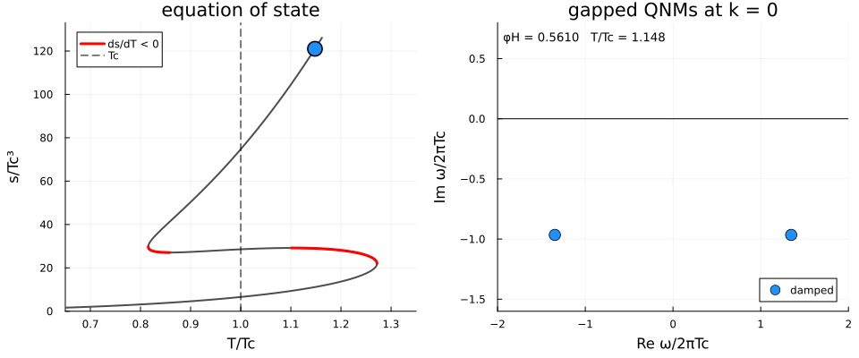

# QUASTELL

```text
    \o/                                                                               \o/
     |                                                                                 |
   o/ \o        ___    _   _      _      ____    _____   _____   _       _           o/ \o
  /|\ /|\      / _ \  | | | |    / \    / ___|  |_   _| | ____| | |     | |         /|\ /|\
 o/ \o/ \o    | | | | | | | |   / _ \   \___ \    | |   |  _|   | |     | |        o/ \o/ \o
/|\ /|\ /|\   | |_| | | |_| |  / ___ \   ___) |   | |   | |___  | |___  | |___    /|\ /|\ /|\
/ \ / \ / \    \__\_\  \___/  /_/   \_\ |____/    |_|   |_____| |_____| |_____|   / \ / \ / \
                          QUAsinormal Spectra of ThErmaL hoLography
```

[](https://arxiv.org/abs/XXXX.XXXXX)
[](LICENSE)

Julia code for the quasinormal modes (QNMs) of five-dimensional holographic black branes with a
self-interacting scalar. The name also reads *qua + castell*: QNMs come in towers, like the
Catalan human towers.

<p align="center">
  
</p>

$\phi_M = 0.8$, $\chi = 1$. Left: the equation of state across the first-order transition.
Right: the gapped QNMs at $k = 0$. Between the two zeros of $ds/dT$ the order-parameter mode is
unstable, even though $c_v > 0$.

```
V(phi) --> background --> thermodynamics, Tc --> fluctuation matrices --> QNMs
           (Newton)       (swallowtail)          (cubic pencil)           (multi-grid filter)
```

Everything is Chebyshev collocation. Spurious eigenvalues are removed by solving on several
grids and by filtering the known artifacts of the master equations
([below](#spurious-modes)).

## The model

The model of Bea and Mateos ([arXiv:1805.01806](https://arxiv.org/abs/1805.01806)):
Einstein gravity in $\mathrm{AdS}_5$ coupled to a scalar with potential ($L = 1$)

$$
W(\phi) = -\frac{3}{2} - \frac{\phi^2}{2} - \frac{\phi^4}{4\phi_M^2} + \frac{\phi^6}{\phi_Q},
\qquad
V(\phi) = -\frac{4}{3}W(\phi)^2 + \frac{1}{2}W'(\phi)^2.
$$

$V = -3 - \frac{3}{2}\phi^2 + \dots$, so $\phi$ is dual to a $\Delta = 3$ operator, whose source
$\Lambda$ breaks conformal invariance. For suitable `phiM` the equation of state $s(T)$ is
multivalued: there is a first-order transition at $T_c$ and a spinodal branch where the plasma
is unstable.

The background is solved with the ansatz of the Mathematica notebook,

$$
ds^2 = \frac{1}{r^2}\left[-f(r) g(r) dt^2 + \frac{dr^2}{f(r)} + g(r)\left(dx^2 + dy^2 + dz^2\right)\right],
\qquad
\phi = r \phi_0(r),
$$

with the boundary at $r = 0$ ($f = g = 1$) and the horizon at $r = 1$ ($f = 0$), so
$T = -f'(1)\sqrt{g(1)}/4\pi$. Branches are labelled by $\phi_H = \phi_0(1)$ (`phiH`), and
$\Lambda = \phi_0(0)$. The fluctuations are solved in ingoing Eddington-Finkelstein time,
$v = t - \int dr/(f\sqrt{g})$, which is regular at the horizon. Below and in the code the radial
coordinate is called $u$.

`chi` multiplies the scalar stress tensor, $G_{\mu\nu} - 6 g_{\mu\nu} = \chi T_{\mu\nu}$, and
`chi = 1` is the model above. In the code `m.V` is $V + 3$.

The QNMs are computed for two gauge-invariant master fields, $Z_\phi$ and $Z_2$, in units
$\lambda = \omega/2\pi T$ and $q = k/2\pi T$. Thermodynamics is in units of $\Lambda$.

## Installation

```bash
git clone https://github.com/<your-user>/QUASTELL.git
cd QUASTELL
julia --project -e 'using Pkg; Pkg.instantiate()'
```

Needs Julia 1.7 or later. The first `using QUASTELL` precompiles Plots and takes a few minutes.
Set `ENV["QUASTELL_BANNER"] = "false"` before loading to hide the banner.

## Quick start

```julia
using QUASTELL

m  = Bea_Mateos(1.0, 10; chi = 1.2)            # phiM, phiQ, chi
bg = background(m, 0.3; N = 40)                # black brane with phiH = 0.3
bg.T / bg.Lambda                               # 0.9087

thermodynamics!(m; N = 50, nphi = 2000)        # s(T); sets m.Tc = 0.3735675
plot_thermodynamics(m)

# phiH = 1.16 is on the spinodal branch, phiH in [1.033, 1.271]
r = qnms(m, 1.16; q = 0.05, Ns = (40, 50, 60), rtol = 1e-4, bcexpand = true)
r.lambda[1]                                    # 6.8e-12 + 0.011068im
plot_qnms(r)
```

Modes are sorted by the imaginary part of $\lambda$, so `r.lambda[1]` is the most unstable one:
sound with $c_s^2 < 0$, which grows instead of propagating. At `phiH = 1.40` the same call gives
damped sound, $\lambda = \pm 0.01939 - 0.00096 i$.

For the eigenfunctions, add `eigenfunctions = true`:

```julia
r = qnms(m, 1.16; q = 0.05, Ns = (40, 50, 60), rtol = 1e-4, bcexpand = true,
         eigenfunctions = true)
plot_eigenfunctions(r; modes = 1:3)
```

The fields are stored in `r.Zphi` and `r.Z2` on the grid `r.u`.

[`notebooks/QUASTELL_demo.ipynb`](notebooks/QUASTELL_demo.ipynb) goes through every function.

## Functions

See the docstrings for details (`?qnms`).

| | Function | Returns |
|---|---|---|
| model | `Bea_Mateos(phiM, phiQ; chi = 1, nu = 1)` | $V$, $V'$, $V''$; caches backgrounds, thermodynamics and QNM runs |
| background | `background(m, phiH; N, warm)` | $f$, $g$, $\phi_0$ on the grid; $T$, $S$, $\Lambda$ |
| thermodynamics | `thermodynamics!(m; N, nphi)` | $s(T)$, pressure, free energy, energy density; sets `m.Tc` |
| | `critical_temperature(s, T, phiH)` | $T_c$ from the swallowtail |
| fluctuations | `mtildes(m, phiH; q, N)` | the matrices of $M(\omega) = \sum_{n=0}^{3} \omega^n M_n$ and its companion form |
| QNMs | `qnms(m, phiH; q, Ns, rtol, cutoff, eigenfunctions)` | converged $\lambda$ sorted by imaginary part, their error, the raw spectra; optionally $Z_\phi(u)$, $Z_2(u)$ |
| | `dispersion(m, phiH; qs, nmodes)` | $\lambda(q)$ of the least damped modes |
| | `sound_speed(d)` | $c_s$ from a dispersion |
| | `growth_rate(m, phiH; qs)` | $\gamma(k)$ of the unstable sound mode, with the fit $\lvert c_s \rvert k - \Gamma k^2/2$ |
| | `singular_band(m, b, q, T)` | the band of $\omega$ where the master equations have an interior singular point |
| plots | `plot_potential`, `plot_solution`, `plot_thermodynamics`, `plot_qnms`, `plot_convergence`, `plot_dispersion`, `plot_growth_rates`, `plot_eigenfunctions` | |

The lower-level steps are exported too: `build_Mtildes`, `divide_eq1_by_f!`,
`rescale_fields!`, `boundary_rows!`, `no_source_row!`, `companion`.

## Mathematica

Several Mathematica codes were developed during this work. These are the ones included here:

- [`mathematica/Derive_the_equations.nb`](mathematica/Derive_the_equations.nb) derives the master
  equations at finite $\omega$ and $k$ and exports their coefficients as Julia (`Mtildes.jl`).
  That export is the coefficient block of `build_Mtildes` in
  [`src/fluctuations.jl`](src/fluctuations.jl). If the equations change, re-run the notebook and
  paste it in again.
- [`mathematica/zero_frequency/`](mathematica/zero_frequency) computes the static modes,
  $\omega = 0$, for $\phi_M = 0.8$ and $\phi_M = 1$ with $\chi = 1$.
  `Derive_static_equations.nb` takes the master equations to $\omega = 0$ and checks the solver's
  coefficients. `QNMsZeroFrequency.nb` solves for $(q/2\pi T)^2$ on the backgrounds
  `Background_N60_phiM_*.m`. A positive eigenvalue is a momentum where a mode crosses
  $\omega = 0$, the edge of an unstable band. Results are written to `Results/`.

## Spurious modes

Most eigenvalues of the discretised problem are artifacts. `qnms` removes them as follows.

1. **Several grids.** A frequency is kept only if it appears on every grid in `Ns`, within
   `rtol * max(1, abs(lambda))`. This is the test of Jansen's
   [QNMspectral](https://github.com/APJansen/QNMspectral).
2. **Singular band.** For $q \neq 0$, collocation puts $N$-independent fake modes where the
   master equations have an interior singular point. They are removed by location (`bandtol`).
   At $q = 0$ the band sits at $\omega = 0$, so eigenvalues with $\lvert\lambda\rvert$ below
   `origintol` are dropped. Use a small $q > 0$ to see the hydrodynamic mode.
3. **Factor of f.** Equation 1 carries a spurious factor $f(u)$, which gives a fake mode at
   $\lambda = -i$. `divide_f = true` (the default) removes it. Trust the sign of the imaginary
   part only with `rtol <= 1e-4`.
4. **Boundary condition.** `bcexpand = true` imposes the no-source condition on the boundary
   expansion. This removes a boundary artifact and improves the light modes by four to five
   orders of magnitude. It is off by default but recommended.

Notes:

- Keep $N \le 60$. Above $N \approx 70$ the background solver stalls (minutes per step), and
  Float64 runs out of digits around $N \approx 120$.
- Cold starts fail above $\phi_H \approx 1.6$. Pass a nearby solution as `warm`.
- `plot_convergence(r)` shows the raw spectra of all grids. Physical modes line up; artifacts
  don't.
- A QNM has $Z_\phi \sim u^3$ at the boundary. The artifact of step 4 has $Z_\phi \sim u$, which
  its `eferr` doesn't show.

## Validation

As $\phi_H \to 0$ the scalar decouples, and the two channels must reproduce the
$\mathrm{AdS}_5$-Schwarzschild towers: $\Delta = 3$ for $Z_\phi$ and $\Delta = 4$ for $Z_2$.
With `phiH = 1e-3`, $q = 0$ and `Ns = (60, 70, 90)`:

| mode | QUASTELL | reference | difference |
|---|---|---|---|
| $Z_\phi$, $n = 1$ | $1.099407474 - 0.879767076 i$ | $1.099407283 - 0.879767314 i$ | $3.1 \times 10^{-7}$ |
| $Z_2$, $n = 1$ | $1.559725860 - 1.373337493 i$ | $1.559725796 - 1.373337872 i$ | $3.8 \times 10^{-7}$ |
| $Z_\phi$, $n = 2$ | $2.105948634 - 1.887443607 i$ | $2.105948627 - 1.887444155 i$ | $5.5 \times 10^{-7}$ |
| $Z_2$, $n = 2$ | $2.584760685 - 2.381784179 i$ | $2.584760 - 2.381785 i$ | $\sim 10^{-6}$ (6-digit reference) |

At $q = 0.05$ the sound mode is $\lambda = 0.028886922 - 0.000833145 i$. Hydrodynamics,
$\lambda = q/\sqrt{3} - i q^2/3$, gives $0.028867513 - 0.000833333 i$. The difference is
$O(q^3)$.

## Tests

```bash
julia --project -e 'using Pkg; Pkg.test()'
```

About six minutes, half of it precompilation.

## Repository layout

```
QUASTELL/
  src/
    QUASTELL.jl         module and exports
    model.jl            Bea_Mateos, Background, QNMResult
    grid.jl             Chebyshev grid
    background.jl       Newton solver for the black brane
    thermodynamics.jl   s(T), free energy, Tc
    fluctuations.jl     fluctuation matrices and boundary conditions
    qnms.jl             spectrum, multi-grid filter, dispersion, growth rate
    plotting.jl
  test/runtests.jl
  notebooks/QUASTELL_demo.ipynb
  assets/               gapmode.gif and the script that makes it
  mathematica/
    Derive_the_equations.nb
    zero_frequency/     static modes at omega = 0
```

## References

If you use QUASTELL, please also cite:

- Y. Bea and D. Mateos, *Heating up Exotic RG Flows with Holography*, JHEP **08** (2018) 034,
  [arXiv:1805.01806](https://arxiv.org/abs/1805.01806). This is the model.
- A. Jansen, *Overdamped modes in Schwarzschild-de Sitter and a Mathematica package for the
  numerical computation of quasinormal modes*, Eur. Phys. J. Plus **132**, 546 (2017),
  [arXiv:1709.09178](https://arxiv.org/abs/1709.09178). This is
  [QNMspectral](https://github.com/APJansen/QNMspectral), whose convergence test `qnms` uses.
- A. Caddeo, O. Henriksson, C. Hoyos and M. Sánchez-Garitaonandia, *Spinodal slowing down and
  scaling in a holographic model*, [arXiv:2406.15297](https://arxiv.org/abs/2406.15297). This is
  Mikel Sánchez-Garitaonandia and Carlos Hoyos's work on the dynamics near the spinodal point.

## License

[MIT](LICENSE).
